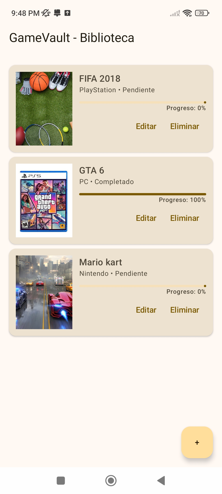
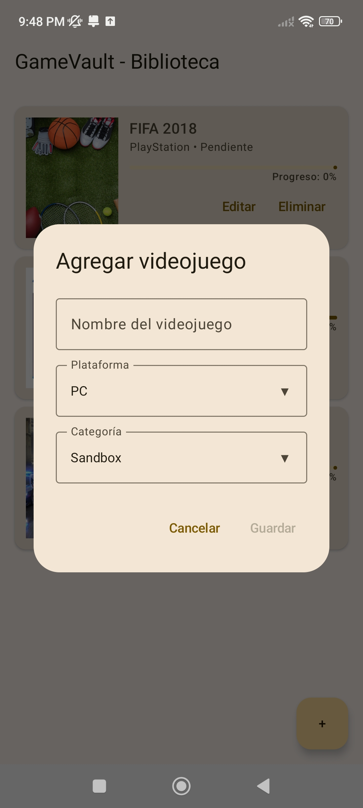
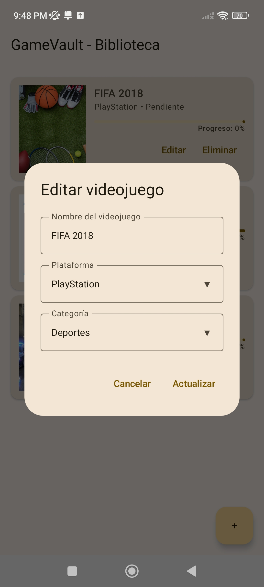
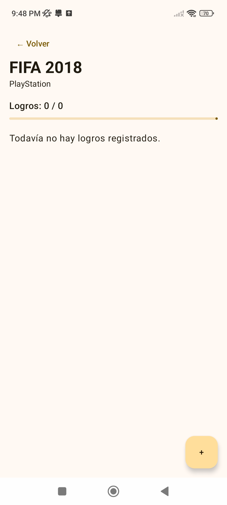
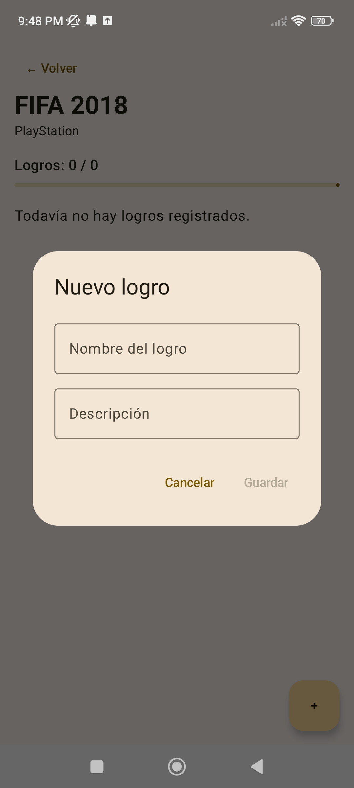

# Repositorio de GitHub

https://github.com/LeonardoMedina123/GameVaul

---

# Integrantes del Equipo

   -Nelly Lizbeth Esparza Aranda

   -Gustavo Eduardo Castro Limón

   -Leonardo Daniel Medina Castañeda

---

# GameVault (`com.example.gamevaul`)

Aplicación móvil para Android desarrollada en **Kotlin** y **Jetpack Compose** que permite administrar una biblioteca personal de videojuegos, organizar los títulos por plataforma y categoría, y llevar un seguimiento automático del progreso mediante un sistema de logros persistente.

---

## 1. Descripción del proyecto

**GameVault** (registrada en el paquete base `com.example.gamevaul`) está diseñada para centralizar el catálogo personal de videojuegos de un usuario. Permite registrar títulos, clasificarlos por plataforma y género/categoría, visualizar portadas asociadas automáticamente y gestionar logros individuales por cada juego.

Toda la información se almacena de forma local mediante **Room Database**, garantizando que la biblioteca, los logros y el porcentaje de avance permanezcan disponibles sin conexión a internet y entre sesiones de uso.

---

## 2. Características principales

### 2.1 Gestión de videojuegos
- **Registro:** Agregar nuevos videojuegos a la biblioteca personal.
- **Edición:** Modificar la información de los títulos existentes (como nombre, plataforma y detalles).
- **Eliminación:** Borrar videojuegos de forma individual o múltiple (`deleteGame` / `deleteGames`), eliminando en cascada sus logros asociados.
- **Consulta:** Visualizar la lista de videojuegos con su portada, plataforma, estado y progreso actualizado.







### 2.2 Plataformas soportadas
Cada videojuego puede clasificarse dentro de una de las siguientes plataformas:
- **PC**
- **PlayStation**
- **Xbox**
- **Nintendo**

### 2.3 Categorías y asignación automática de portadas
Al seleccionar una categoría para el videojuego, la aplicación asigna automáticamente el recurso gráfico correspondiente para su visualización en la biblioteca:

| Categoría | Recurso de portada (`drawable`) |
| :--- | :--- |
| Plataformas | `platformer.png` |
| Sandbox | `sandbox.png` |
| Carreras | `carreras.png` |
| Deportes | `deportes.png` |
| Disparos | `disparos.png` |

### 2.4 Sistema de logros
Cada videojuego dispone de su propia pantalla de administración de logros donde es posible:
- Registrar nuevos logros asociados al título.
- Consultar el listado completo de logros del juego.
- Marcar logros como completados o desmarcarlos en cualquier momento.
- Eliminar logros de forma individual o múltiple (`deleteAchievement` / `deleteAchievements`).





### 2.5 Seguimiento automático del progreso y estado
- El porcentaje de progreso de cada videojuego se calcula automáticamente a partir de la relación entre **logros completados** y **total de logros registrados**.
- Cada vez que se agrega, elimina, completa o desmarca un logro, el progreso y el estado del juego se recalculan y reflejan de manera reactiva en la interfaz.

---

## 3. Tecnologías y herramientas utilizadas

| Tecnología | Propósito en el proyecto |
| :--- | :--- |
| **Kotlin** | Lenguaje principal de desarrollo. |
| **Jetpack Compose** | Construcción declarativa de todas las pantallas y diálogos de la interfaz. |
| **Material 3** | Sistema de diseño, componentes visuales, tipografía y esquema de color. |
| **Room Database** | Persistencia local estructurada sobre SQLite. |
| **KSP (Kotlin Symbol Processing)** | Generación en tiempo de compilación de las implementaciones de DAOs y base de datos (`*_Impl`). |
| **Kotlin Coroutines** | Ejecución asíncrona de operaciones de lectura y escritura en base de datos. |
| **StateFlow** | Manejo de estado reactivo entre la capa de datos, los `ViewModel` y la UI en Compose. |
| **Gradle (v9.6.0)** | Sistema de automatización de compilación y gestión de dependencias. |

---

## 4. Arquitectura y estructura del proyecto

La aplicación sigue una arquitectura desacoplada inspirada en **MVVM (Model - View - ViewModel)** con flujo unidireccional de datos:

```text
com.example.gamevaul
│
├── MainActivity.kt                  # Punto de entrada principal y configuración de navegación/UI
│
├── data                             # Capa de persistencia y modelos de datos (Room)
│   ├── GameEntity.kt                # Entidad que representa un videojuego
│   ├── AchievementEntity.kt         # Entidad que representa un logro
│   ├── GameWithProgress.kt          # Modelo relacional/proyección con el progreso del juego
│   ├── GameDao.kt                   # Interfaz de acceso a datos para videojuegos
│   ├── AchievementDao.kt            # Interfaz de acceso a datos para logros
│   ├── GameDatabase.kt              # Definición de la base de datos Room y migraciones (MIGRATION_1_2)
│   └── DatabaseProvider.kt          # Proveedor singleton de la instancia de GameDatabase
│
├── viewmodel                        # Capa de lógica de presentación y estado reactivo
│   ├── GameViewModel.kt             # Gestión de estado y operaciones CRUD de videojuegos
│   └── AchievementViewModel.kt      # Gestión de estado y operaciones CRUD de logros
│
└── ui                               # Capa de interfaz de usuario en Jetpack Compose
    ├── GameListScreen.kt            # Pantalla principal con el catálogo de videojuegos
    ├── AddGameDialog.kt             # Diálogo modal para registrar y editar videojuegos
    ├── AchievementScreen.kt         # Pantalla de gestión de logros de un videojuego
    └── theme                        # Definición visual de Material 3
        ├── Color.kt                 # Paleta de colores de la aplicación
        ├── Theme.kt                 # Configuración del tema claro/oscuro y esquemas de color
        └── Type.kt                  # Estilos tipográficos
